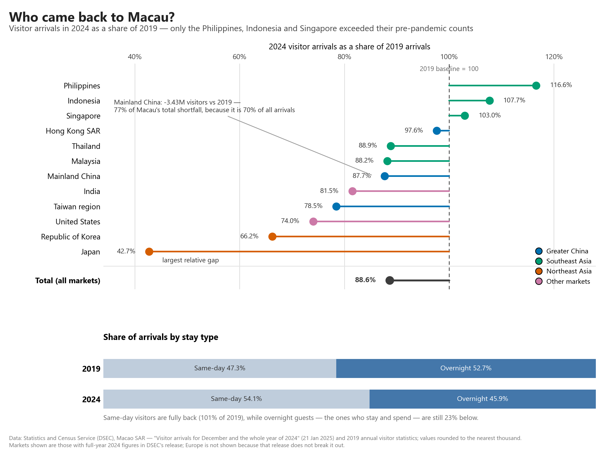

# GAO TE

**Data science student · Macau**

I am a student in CISC7204 *Data Science and Data Visualization* at the University
of Macau. I am interested in the part of data analysis that comes after the
model runs: turning a table of numbers into a claim that a reader can check, and
being explicit about what the data cannot tell you. Most of what I build starts
from a public dataset and a question that a headline has already answered too
quickly.

This site collects my data science work. Everything here is reproducible: each
project links to its repository, where the code, the data and the instructions to
run the analysis are kept together.

---

## Technical skills

- **Languages:** Python (primary), SQL (basic)
- **Data analysis:** pandas, NumPy — cleaning, reshaping, joining, group
  aggregation, index construction
- **Visualisation:** matplotlib — custom static figures, colourblind-safe
  palettes, annotated charts designed for print as well as screen
- **Tools:** Jupyter Notebook, Git and GitHub, VS Code
- **Practice:** writing reproducible analysis scripts, documenting data sources
  and permissions, reviewing a chart for misleading encodings

---

## Project showcase

### Who came back to Macau? Post-pandemic recovery of visitor arrivals

**Research question.** Macau welcomed 34.9 million visitors in 2024 — its best
year since the pandemic, but only 88.6% of the 2019 record. Rather than repeat
that headline, this project asks which source markets actually came back, how
much of the remaining 4.48-million-visitor gap each one accounts for, and whether
the visitors returning are the same kind of visitors Macau used to attract.

**What the analysis found.** The recovery is real but narrow. Only three of the
twelve source markets DSEC reports individually — the Philippines, Indonesia and
Singapore — exceeded their 2019 arrivals, while Japan (42.7%) and the Republic of
Korea (66.2%) remain furthest behind. More importantly, the aggregate gap is not
spread evenly: Mainland China sits at 87.7% of 2019, and that single market
accounts for 3.43 million of the 4.48 million missing visitors — 77% of the
entire shortfall — because it supplies 70% of all arrivals. The composition of
the recovery differs too: same-day visitors are fully back (101% of 2019) and now
make up 54% of arrivals, while overnight guests, the ones who stay and spend, are
still 23% below their pre-pandemic level. The honest summary is that Macau
recovered volume where it was already dominant, and that depth, not volume, is
where the gap remains.

A second figure plots market size against recovery, because a percentage on a
small market and a percentage on a 24.5-million market are not the same kind of
fact:

**Data and methods.** Arrivals by source market for 2019 and 2024 from the
Statistics and Census Service (DSEC) of the Macao SAR — official, aggregate,
publicly released statistics containing no personal data. Analysis in Python with
pandas; figures drawn with matplotlib; compared on an index (2024 as a percentage
of 2019) so that markets of very different size are on one scale.

**Limitations.** Two points in time can describe a difference; they cannot
describe a recovery. With snapshots for 2019 and 2024 and nothing in between,
this analysis cannot tell whether arrivals climbed back gradually or arrived in
one jump, and it treats 2019 as the level to return to — an assumption, not a
finding. Japan is the clearest case: at 42.7% of 2019 it may be "not yet back" or
"no longer coming", and two data points cannot separate those two stories.
Second, overnight stays are used here as a proxy for higher spending, and this
data does not support that step: what is plotted is arrivals, not visitor
expenditure, so overnight arrivals being 23% below 2019 does not mean tourism
revenue is 23% below. Third, the analysis is descriptive — it does not test why
Japan and the Republic of Korea lag, and visa policy, airline capacity and
exchange rates are outside what these tables can answer.

**Project repository:** <https://github.com/terrygao44/data-science-project>

**Project status:** **Completed** — October 2026.

---

## How I work

1. State the question before touching the data.
2. Keep the raw numbers in the repository and generate every figure from a
   script, so any reader can re-run the analysis and get the same picture.
3. Record where the data came from and what may be done with it.
4. Name the limitation in the write-up instead of leaving it for the reader to
   find.

## Contact

- GitHub: [@terrygao44](https://github.com/terrygao44)
